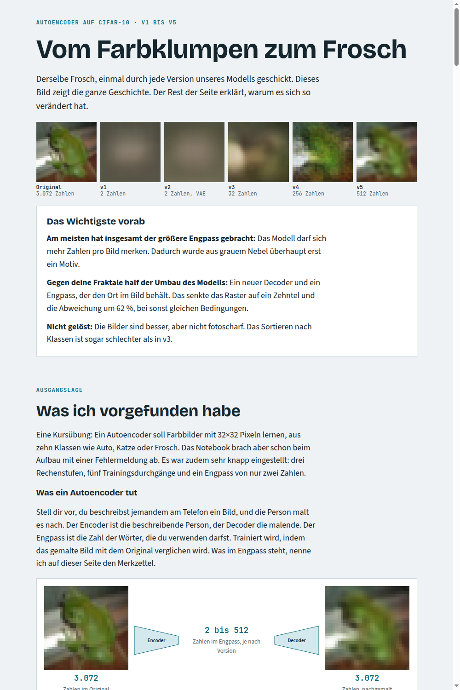

# Vom Farbklumpen zum Frosch

Ein Autoencoder auf CIFAR-10, Schritt für Schritt von v1 bis v6 verbessert. Entstanden im CAS Generative AI, Modul 2, Tag 3.

[](https://claude.ai/artifact/HvTcvwZd3tdFHB2sB4nnF6)

**[Zur interaktiven Erklärseite](https://claude.ai/artifact/HvTcvwZd3tdFHB2sB4nnF6)** mit Bildvergleich, Cluster-Bildern und Erklärungen zu jeder Version.

## Schnellstart

Die Notebooks laden fertig trainierte Modelle aus `models/`. Niemand muss neu trainieren, eine GPU ist nicht nötig.

```bash
git clone https://github.com/trosinde/cas_module_2_day3_encoder_decoder.git
cd cas_module_2_day3_encoder_decoder
python3.12 -m venv .venv
source .venv/bin/activate
pip install -r requirements.txt
jupyter-execute autoencoder_on_CIFAR-10_v5_sharp_decoder.ipynb --output=ergebnis.ipynb
```

Auf dem Entwicklungsrechner liefen die Notebooks auf der CPU in 14 bis etwa 60 Sekunden. CIFAR-10, Fashion-MNIST und die VGG-Gewichte lädt Keras beim ersten Start herunter.

Zum Neutrainieren in den Parametern eines Notebooks `TRAIN_MODEL = True` setzen.

## Notebooks

| Notebook | Inhalt | Lädt |
|---|---|---|
| `autoencoder_on_CIFAR-10_v1_bugfix` | Kursübung repariert, Engpass 2 Zahlen | `models/autoencoder_v1.keras` |
| `autoencoder_on_CIFAR-10_v2_vae` | Umbau zum VAE | `models/encoder_v2.keras`, `decoder_v2.keras` |
| `autoencoder_on_CIFAR-10_v3_latent_quality` | Engpass 32, tieferes Modell, MSE | `models/autoencoder_v3.keras` |
| `autoencoder_on_CIFAR-10_v4_perceptual_loss` | Engpass 256, VGG-Prüfer, Fraktale | `models/autoencoder_v4.keras` |
| `autoencoder_on_CIFAR-10_v5_sharp_decoder` | Neuer Decoder, Karte als Engpass, L1 + SSIM | `models/autoencoder_v5.keras` |
| `autoencoder_on_CIFAR-10_v6_sharpness` | Längeres Training, GAN, Schärfefilter, Super-Resolution. **Folgt nach Abschluss der Läufe.** | `v6_experiments/runs/` |

Aus dem Kurs:

| Notebook | Inhalt | Lädt |
|---|---|---|
| `autoencoder` | Autoencoder auf Fashion-MNIST | `models/autoencoder_course.keras` |
| `autoencoder_on_CIFAR-10` | Ausgangspunkt der Übung, **bricht unverändert mit dem ursprünglichen Fehler ab**. v1 enthält die Korrektur | – |

## Was anders ist als im ursprünglichen Lauf

- **v4:** Vom ersten v4-Lauf war kein Modell gespeichert. `autoencoder_v4.keras` stammt aus einem Nachlauf mit demselben Modell und Prüfer (R0 in `v5_experiments/`).
- **Kurs-Modell:** einmalig mit den Einstellungen des Notebooks trainiert, 3 Epochen.
- **Ausgaben:** Die gespeicherten Ausgaben der Notebooks stammen aus dem Lauf mit geladenen Modellen. Trainingsverläufe stehen deshalb nicht mehr darin.
- **Cluster-Bilder:** t-SNE und die zufälligen Punkte des VAE sind nicht exakt reproduzierbar. Die Cluster können sich von Lauf zu Lauf unterscheiden.

## Ordner

| Ordner | Inhalt |
|---|---|
| `models/` | Trainierte Modelle |
| `v5_experiments/` | Skripte, Messwerte und Einzelvergleiche zu v5 |
| `v6_experiments/` | Skripte, Messwerte und Gewichte zu v6, Quellen der Erklärseite |
| `docs/` | Kopie der Erklärseite als HTML-Datei und Vorschaubild |

## Quellen

- [CIFAR-10](https://www.cs.toronto.edu/~kriz/cifar.html) und Fashion-MNIST, geladen über `keras.datasets`.
- [Real-ESRGAN](https://github.com/xinntao/Real-ESRGAN) von Xintao Wang, BSD-3-Clause. Die Gewichte sind nicht im Repo, `phase4b_sr.py` lädt sie aus dem offiziellen Release.
